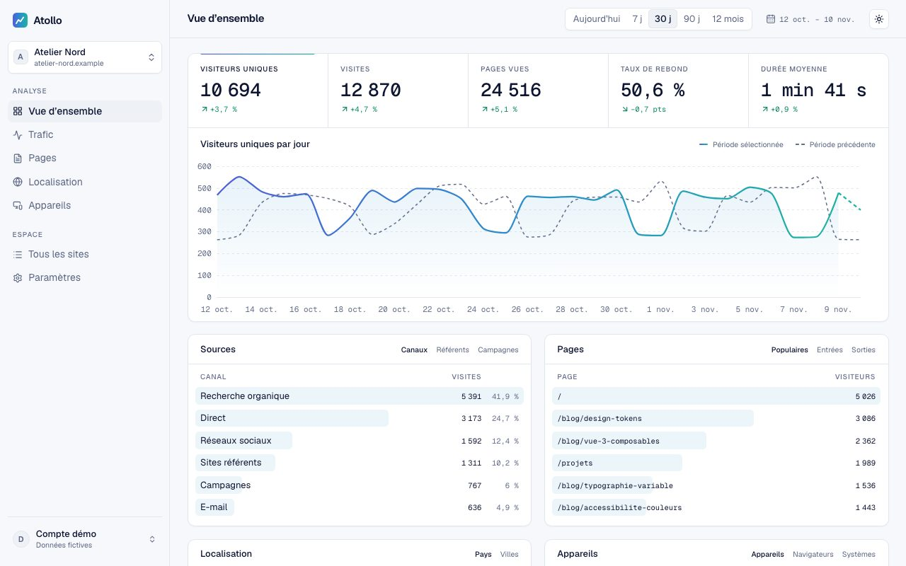
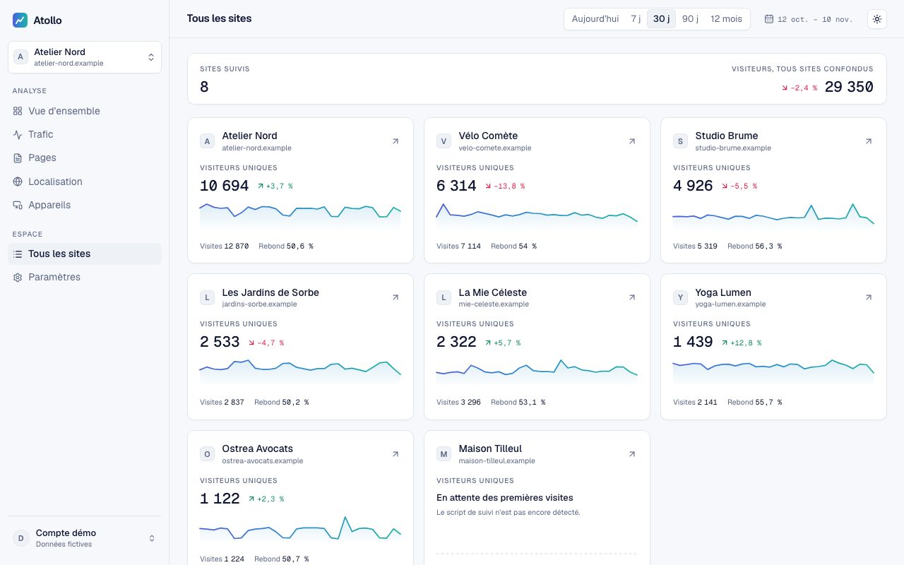
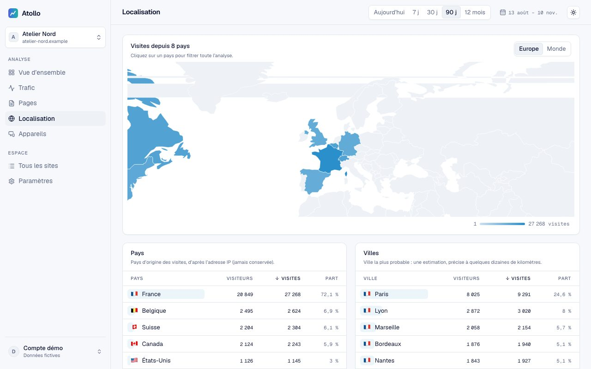
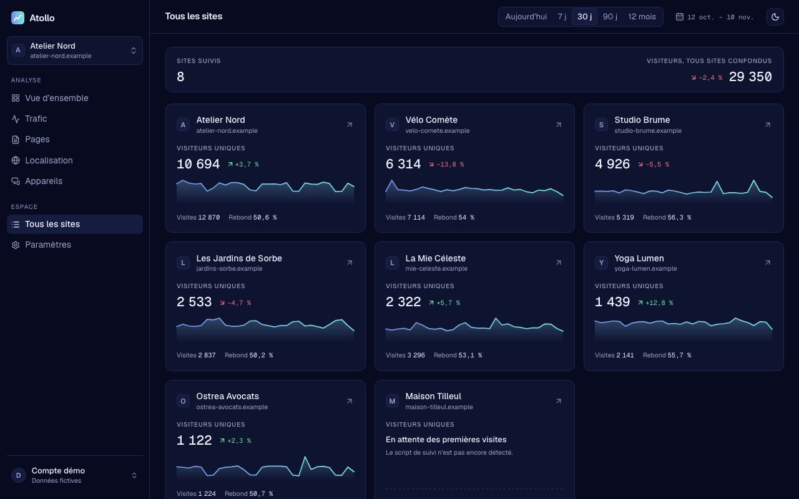
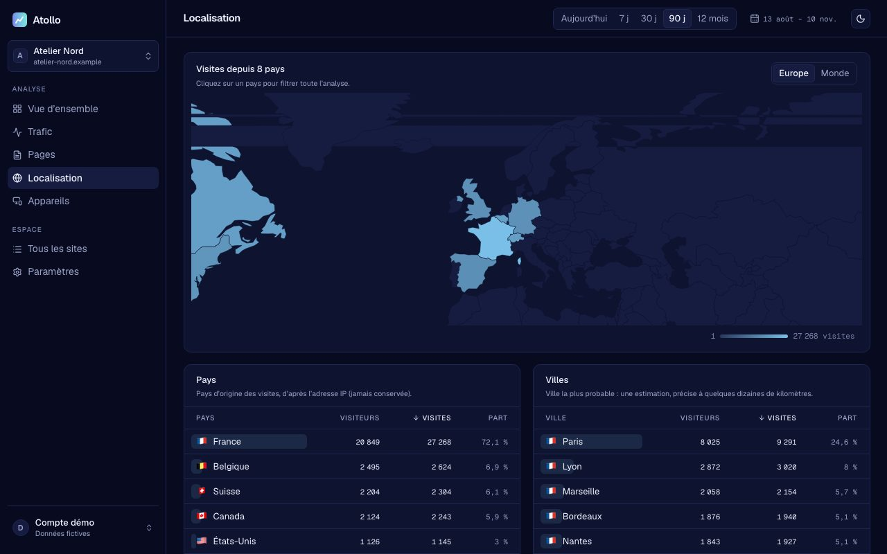
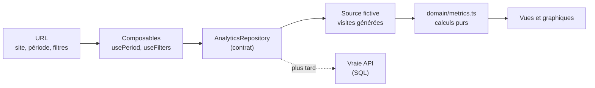

# Atollo

Dashboard d'analytics web multi-sites, pensé pour les freelances et les agences qui suivent plusieurs sites clients. Interface sobre, statistiques lisibles, respect de la vie privée.

**[Voir la démo en ligne → atollo.vercel.app](https://atollo.vercel.app/)** (bouton « Explorer la démo », sans inscription)

> Projet personnel de portfolio, construit étape par étape. Toutes les données affichées sont **fictives** (voir [Données de démonstration](#données-de-démonstration)).

<picture>
  <source media="(prefers-color-scheme: dark)" srcset="public/screenshots/overview-dark-1280.jpg">
  
</picture>

## Sommaire

- [Fonctionnalités](#fonctionnalités)
- [Aperçu](#aperçu)
- [Stack technique](#stack-technique)
- [Démarrer](#démarrer)
- [Architecture](#architecture)
- [Choix techniques](#choix-techniques)
- [Qualité : tests, accessibilité, performances](#qualité--tests-accessibilité-performances)
- [Déploiement](#déploiement)
- [Limites actuelles et suite](#limites-actuelles-et-suite)
- [Crédits et licences](#crédits-et-licences)

## Fonctionnalités

- **Comptes** : inscription, connexion, mot de passe oublié, déconnexion, pages protégées, et un bouton « Explorer la démo » pour tout voir sans s'inscrire.
- **Sites** : chaque compte ajoute, renomme et supprime ses propres sites, avec le code de suivi à copier. Le compte de démonstration est en lecture seule.
- **Vue multi-sites** : tous les sites sur la même période, avec visiteurs, évolution et mini-graphique de tendance.
- **Vue d'ensemble** d'un site : visiteurs uniques, visites, pages vues, taux de rebond et durée moyenne, avec l'évolution par rapport à la période précédente.
- **Graphique d'évolution** superposé à la période de comparaison, pour la métrique choisie. La journée (ou l'heure) en cours est signalée, pour ne pas être lue comme une chute.
- **Répartitions** : sources (canaux, référents, campagnes), pages (populaires, entrées, sorties), pays et villes sur une carte, appareils, navigateurs et systèmes.
- **Filtres croisés** : un clic sur une ligne (« Recherche organique », « Mobile »…) filtre tout le tableau de bord.
- **État dans l'URL** : période, métrique et filtres se partagent par simple lien et suivent le bouton retour.
- **Périodes** : aujourd'hui, 7, 30 ou 90 jours, 12 mois (comparés à l'année précédente) ou période personnalisée via un calendrier.
- **Paramètres** : profil, e-mail, mot de passe, suppression du compte, gestion des sites, thème.
- Thème clair, sombre ou système, interface responsive et navigable au clavier, états de chargement, vides et d'erreur.

## Aperçu

| Vue multi-sites                                                                                                                         | Carte des visiteurs                                                                                                                                  |
| --------------------------------------------------------------------------------------------------------------------------------------- | ---------------------------------------------------------------------------------------------------------------------------------------------------- |
|  |  |
|                                                       |                                                                          |

Les captures sont de vrais écrans du compte de démonstration, régénérés par `npm run capture`.

## Stack technique

Vue 3 (Composition API) · TypeScript strict · Vite · Vue Router · Pinia · Tailwind CSS v4 · Reka UI · Apache ECharts · VueUse · date-fns · Zod · Vitest · Playwright · axe-core

## Données de démonstration

Les statistiques sont calculées à partir de visites **générées** : un générateur déterministe produit, jour par jour, des visites réalistes (croissance, week-ends, heures de pointe, sources, appareils…). Aucune donnée réelle n'est collectée ni affichée.

Les huit sites de démonstration (Atelier Nord, Studio Brume, La Mie Céleste, Vélo Comète, Les Jardins de Sorbe, Yoga Lumen, Ostrea Avocats, Maison Tilleul) sont **des entreprises imaginaires**, chacune avec son propre profil d'audience. Leurs adresses utilisent le domaine réservé `.example` ([RFC 2606](https://www.rfc-editor.org/rfc/rfc2606)), qui ne peut appartenir à personne. Les grandes plateformes citées comme sources de trafic (moteurs de recherche, réseaux sociaux…) le sont uniquement à titre d'exemple.

Un site ajouté par un utilisateur affiche zéro visite : aucun script de suivi ne lui envoie encore de données, et l'application ne fait pas semblant.

## Démarrer

Prérequis : Node.js 24 (`nvm use` lit le fichier `.nvmrc`).

```bash
npm install
npm run dev
```

L'application est disponible sur http://localhost:5173. Le bouton « Explorer la démo » connecte au compte de démonstration ; on peut aussi créer un compte (il reste dans le navigateur, voir ci-dessous).

| Commande             | Rôle                                                                   |
| -------------------- | ---------------------------------------------------------------------- |
| `npm run dev`        | Serveur de développement                                               |
| `npm run build`      | Vérification des types + build de production                           |
| `npm run preview`    | Sert le build de production localement                                 |
| `npm run type-check` | Vérification TypeScript (vue-tsc)                                      |
| `npm run lint`       | Oxlint puis ESLint, avec correction automatique                        |
| `npm run format`     | Formatage Prettier                                                     |
| `npm test`           | Tests unitaires (Vitest)                                               |
| `npm run test:e2e`   | Tests de bout en bout et audit d'accessibilité (Playwright, port 5191) |
| `npm run capture`    | Captures d'écran de la page d'accueil (serveur de dev lancé)           |
| `npm run build:map`  | Régénère le fichier de la carte du monde                               |

## Architecture

```
src/
├─ features/          un dossier par domaine fonctionnel
│  ├─ analytics/
│  │  ├─ domain/      calculs purs : métriques, périodes, filtres (sans Vue)
│  │  ├─ data/        contrat AnalyticsRepository + source fictive (générateur)
│  │  ├─ composables/ état dérivé de l'URL : période, filtres, requêtes
│  │  ├─ components/  bandeau de chiffres clés, répartitions, tableaux
│  │  └─ views/       vue d'ensemble, trafic, pages, localisation, appareils
│  ├─ auth/           comptes et session (contrat AuthService)
│  ├─ sites/          sites d'un compte (contrat SitesService), changement de site
│  ├─ settings/       profil, compte, sites, apparence
│  └─ landing/        page d'accueil publique
├─ shared/            composants d'interface, graphiques, utilitaires
├─ layouts/           barre latérale, barre du haut, menus
└─ router/            routes et garde de navigation
```

Le parcours d'une statistique, de la donnée à l'écran :



- **Trois contrats, une ligne à changer.** L'interface ne parle qu'à `AnalyticsRepository`, `AuthService` et `SitesService`. Chacun a aujourd'hui une implémentation simulée, choisie dans un seul fichier `data/index.ts` : brancher un vrai backend ne touchera aucun composant.
- **Les calculs sont purs.** `domain/metrics.ts` prend une liste de visites et renvoie des chiffres. Il ne dépend ni de Vue ni de la source des données, ce qui le rend simple à tester.
- **L'URL est la source de vérité.** Le site, la période, la métrique et les filtres vivent dans l'adresse ; les composables la lisent et l'écrivent. Pinia ne garde que ce qui est vraiment global : l'utilisateur connecté et ses sites.
- **La garde de navigation** charge les sites du compte avant chaque page protégée, redirige vers la connexion si besoin et affiche une page 404 pour un site inconnu.
- Les tests unitaires sont à côté du fichier testé (`Foo.ts` → `Foo.spec.ts`), les tests de bout en bout dans `e2e/`.

## Choix techniques

| Choix                                                  | Pourquoi                                                                                                                                                                                                                                                                                            |
| ------------------------------------------------------ | --------------------------------------------------------------------------------------------------------------------------------------------------------------------------------------------------------------------------------------------------------------------------------------------------- |
| **Visites brutes générées**, pas des chiffres inventés | Tous les chiffres sont calculés à partir des mêmes visites : la somme des sources égale le total, et changer de période reste cohérent. Chaque jour a sa propre graine (`atelier-nord:2026-11-09`), donc le 9 novembre affiche les mêmes chiffres en « 7 j », « 30 j » ou en période personnalisée. |
| **Comparaison à la période précédente**                | Un chiffre seul ne dit rien ; « +12 % par rapport aux 30 jours d'avant » se lit tout de suite. La variation vaut `null` (et non l'infini) quand la période précédente est vide.                                                                                                                     |
| **ECharts** plutôt que Chart.js                        | Carte du monde native, info-bulle partagée entre séries, et import par modules : seul ce qui sert est téléchargé.                                                                                                                                                                                   |
| **Reka UI** + Tailwind                                 | Menus, dialogues, onglets et calendrier accessibles (clavier, focus, ARIA) sans imposer de style : l'identité visuelle reste propre au projet.                                                                                                                                                      |
| **Zod**                                                | Une seule description des règles d'un formulaire, utilisée pour la validation et pour les types TypeScript.                                                                                                                                                                                         |
| **Pas de serveur** pour l'instant                      | La démo tourne entièrement dans le navigateur : elle reste disponible sans base de données à héberger ni à mettre en pause.                                                                                                                                                                         |
| **Mots de passe hachés** même en simulation            | Les comptes simulés sont stockés dans le `localStorage`, avec un sel et un hachage, jamais en clair. Aucun e-mail n'est envoyé.                                                                                                                                                                     |
| **Latence simulée**                                    | Les sources fictives répondent en 150 à 400 ms, comme un vrai réseau : les états de chargement sont réellement visibles et testés.                                                                                                                                                                  |

## Qualité : tests, accessibilité, performances

- **Tests unitaires (Vitest, 194 tests)** : calculs des métriques, périodes et granularités, filtres, générateur, services simulés, stores, composants clés.
- **Tests de bout en bout (Playwright, 111 tests)** sur ordinateur et mobile : inscription et connexion, ajout et suppression de sites, changement de période, filtres croisés, page d'accueil. Les éléments sont trouvés par leur rôle et leur nom accessible, comme le ferait un lecteur d'écran.
- **Audit d'accessibilité automatisé** avec axe-core (règles WCAG 2.2 A et AA) sur toutes les pages, en thème clair et sombre, ainsi que dans un dialogue ouvert, un menu ouvert et le menu mobile. Les graphiques sont doublés d'un résumé textuel ou d'un tableau, les contrastes atteignent au moins 4,5:1, et les animations respectent `prefers-reduced-motion`.
- **Performances** : chaque page est chargée à la demande, les graphiques (et ECharts avec eux) après le reste de la page, avec une nouvelle tentative si le téléchargement échoue. Les captures de la page d'accueil existent en deux tailles (`srcset`) : un écran classique télécharge la version légère.
- **Lint et types** : TypeScript strict, Oxlint et ESLint (règles Vue, Vitest et Playwright), Prettier.

## Déploiement

Hébergé sur [Vercel](https://vercel.com), qui redéploie à chaque push sur `main`. Le fichier `vercel.json` :

- renvoie toutes les adresses vers `index.html`, pour que les liens directs vers une page de l'application fonctionnent ;
- met en cache pendant un an les fichiers du build, dont le nom change à chaque version ;
- ajoute des en-têtes de sécurité (protection contre l'intégration dans une autre page, contre le contenu mal interprété, et limitation des informations envoyées aux autres sites).

La page d'accueil a ses balises de partage (Open Graph) et une image d'aperçu générée à partir du vrai produit.

## Limites actuelles et suite

Ce qui est volontairement simulé aujourd'hui, et ce qui viendrait ensuite :

- **Comptes et sites** restent dans le navigateur où ils ont été créés. Prochaine étape : un vrai backend (par exemple Supabase, avec des règles d'accès par compte) derrière les contrats existants.
- **Le code de suivi** affiché est un aperçu. À construire : un script léger et sans cookies, un point d'entrée qui enregistre les visites, et des calculs faits côté base de données plutôt que dans le navigateur.
- **Un plugin WordPress** pour installer le suivi sans toucher au code du thème.
- Sur « 12 mois », les calculs (plusieurs dizaines de milliers de visites) pourraient passer dans un Web Worker pour ne jamais bloquer l'interface.

## Crédits et licences

Atollo s'appuie sur ces projets open source :

| Projet                                                                                                                                         | Usage                                                   | Licence                            |
| ---------------------------------------------------------------------------------------------------------------------------------------------- | ------------------------------------------------------- | ---------------------------------- |
| [Vue.js](https://vuejs.org), [Vue Router](https://router.vuejs.org), [Pinia](https://pinia.vuejs.org)                                          | Framework, routage, état                                | MIT                                |
| [VueUse](https://vueuse.org)                                                                                                                   | Utilitaires Vue                                         | MIT                                |
| [Reka UI](https://reka-ui.com)                                                                                                                 | Composants accessibles (menus, onglets, dialogues)      | MIT                                |
| [Tailwind CSS](https://tailwindcss.com)                                                                                                        | Styles                                                  | MIT                                |
| [Apache ECharts](https://echarts.apache.org)                                                                                                   | Graphiques                                              | Apache 2.0                         |
| [vue-echarts](https://github.com/ecomfe/vue-echarts)                                                                                           | Intégration d'ECharts dans Vue                          | MIT                                |
| [Lucide](https://lucide.dev)                                                                                                                   | Icônes                                                  | ISC                                |
| [Zod](https://zod.dev)                                                                                                                         | Validation des formulaires                              | MIT                                |
| [date-fns](https://date-fns.org)                                                                                                               | Calculs de dates                                        | MIT                                |
| [Natural Earth](https://www.naturalearthdata.com) (via [world-atlas](https://github.com/topojson/world-atlas))                                 | Contours des pays de la carte                           | Domaine public (world-atlas : ISC) |
| [topojson-client](https://github.com/topojson/topojson-client), [i18n-iso-countries](https://github.com/michaelwittig/node-i18n-iso-countries) | Génération du fichier de la carte (`npm run build:map`) | ISC, MIT                           |
| [Geist et Geist Mono](https://vercel.com/font) (via [Fontsource](https://fontsource.org))                                                      | Polices                                                 | SIL Open Font License 1.1          |
| [Vite](https://vite.dev), [Vitest](https://vitest.dev)                                                                                         | Outillage, tests unitaires                              | MIT                                |
| [Playwright](https://playwright.dev)                                                                                                           | Tests de bout en bout                                   | Apache 2.0                         |
| [TypeScript](https://www.typescriptlang.org)                                                                                                   | Typage                                                  | Apache 2.0                         |

Les textes complets de ces licences sont fournis avec chaque paquet (dossier `node_modules` après `npm install`).

Le design s'inspire de l'esthétique sobre d'outils comme Linear, Vercel ou Plausible ; aucun code, logo ni ressource graphique de ces produits n'a été repris.

## Auteure

Laura Dimitroff — [github.com/lauradimitroff](https://github.com/lauradimitroff)

© 2026 Laura Dimitroff. Code publié à titre de démonstration, tous droits réservés.
